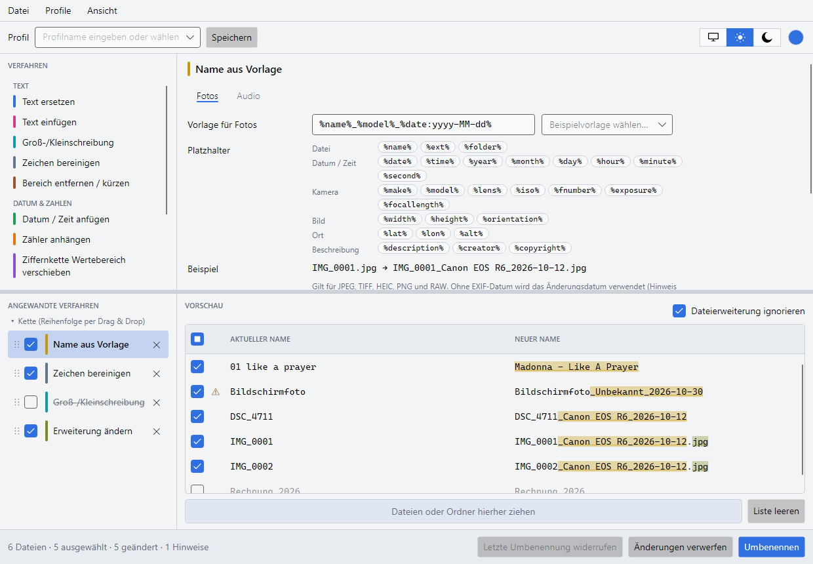

# FileRenamer

Plattformübergreifende Desktopanwendung zum **kaskadierenden Umbenennen von Dateien** – einzeln oder
im Stapel. Mehrere Umbenennungsverfahren werden zu einer Kette verbunden; eine farbige Echtzeitvorschau
zeigt jederzeit, wie die Dateien heißen werden. Erst nach Bestätigung wird tatsächlich umbenannt.



## Funktionen

- **Elf Verfahren** in vier Gruppen, beliebig kombinierbar und mehrfach verwendbar:
  - *Text:* **Text ersetzen** (auch reguläre Ausdrücke), **Text einfügen**, **Groß-/Kleinschreibung**
    (u. a. PascalCase, camelCase, snake_case, kebab-case), **Zeichen bereinigen** (Leerzeichen, Umlaute, Akzente),
    **Bereich entfernen / kürzen**
  - *Datum & Zahlen:* **Datum / Zeit anfügen** (Erstellungs-, Änderungs- oder EXIF-Aufnahmedatum),
    **Zähler anhängen**, **Ziffernkette Wertebereich verschieben** (`name-001` + 100 → `name-101`)
  - *Metadaten & Ordner:* **Name aus Vorlage** mit EXIF- bzw. Audio-Tags
    (`%artist% - %title%` → `Madonna - Like A Prayer`) – eigene Vorlagen lassen sich speichern –, **Ordnername einfügen**
  - *Erweiterung:* **Erweiterung ändern** (`.JPEG` → `.jpg`)
- **Metadaten ohne Fremdbibliothek:** JPEG, TIFF, HEIC, PNG, RAW (DNG, CR2, CR3, NEF, ARW, ORF, RW2, RAF, PEF),
  MP3 (ID3), FLAC, M4A
- **Kette** per Drag & Drop sortieren, Verfahren per Checkbox ein- und ausschalten
- **Vorschau** mit Hervorhebung in der Farbe des jeweiligen Verfahrens, Hinweisen und Konflikten
- **Dateiauswahl** per Checkbox – nur ausgewählte Dateien werden umbenannt
- **Sicheres Umbenennen**: Konfliktprüfung (doppelte oder ungültige Namen, vorhandene Dateien),
  Alles-oder-nichts-Ausführung, Namenstausch a ↔ b, **Widerrufen** der letzten Umbenennung
- **Dateierweiterung ignorieren** (nur die letzte Endung)
- **Profile** zum Speichern, Laden und Zurücksetzen ganzer Ketten
- **Theme**: System, Hell oder Dunkel – dazu eine wählbare **Akzentfarbe** (Pastell mit einstellbarer Sättigung,
  kräftige und neutrale Farben, eigene Hex-Farben)
- **Sprache**: Deutsch oder Englisch, automatisch nach Systemsprache oder fest gewählt; Wechsel ohne Neustart

## Voraussetzungen

| | |
|---|---|
| Betriebssystem | Windows 10/11, Linux, macOS ab 14 |
| Zum Bauen | .NET SDK 10.0 |

## Schnellstart

```bash
dotnet run --project src/FileRenamer.App
```

Tests ausführen:

```bash
dotnet test --project tests/FileRenamer.Core.Tests
```

Eigenständig veröffentlichen (Beispiel Windows x64; für Linux `linux-x64`, für macOS `osx-arm64`):

```bash
dotnet publish src/FileRenamer.App -c Release -r win-x64 --self-contained
```

## Projektaufbau

| Pfad | Inhalt |
|------|--------|
| `src/FileRenamer.Core` | Fachlogik (Verfahren, Vorschau, Konfliktprüfung, Umbenennen, Profile) ohne Oberflächenabhängigkeit |
| `src/FileRenamer.App` | Avalonia-Oberfläche (MVVM) |
| `tests/FileRenamer.Core.Tests` | Unit- und Integrationstests (xUnit) |
| `testdata/` | Testdateien je Verfahren |
| `docs/` | Anwender- und Entwicklerdokumentation |
| `mockups/` | Gestaltungsentwürfe |

Technik: .NET 10 (LTS), Avalonia 12, CommunityToolkit.Mvvm, xUnit v3 – keine weiteren Abhängigkeiten.

## Dokumentation

- [Anwenderdokumentation](docs/ANWENDER.md) – Bedienung, Verfahren, Profile, Hinweise und Konflikte
- [Entwicklerdokumentation](docs/ENTWICKLER.md) – Architektur, Projektbaum, Programmablaufpläne, Erweiterung
- [Protokoll](PROTOKOLL.md) – Fragen, Entscheidungen, Fortschritt
- [Abnahmeprotokoll](ABNAHME.md)
- [Spezifikation](SPECS.md)

## Bekannte Einschränkungen

- Getestet unter Windows; Linux und macOS sind nicht geprüft.
- Unter Linux wird statt des Erstellungsdatums das Änderungsdatum verwendet (mit Hinweis).
- Kein Installer und kein macOS-App-Bundle.
- Widerrufen gilt für die letzte Umbenennung bis zum Programmende.
- Die Metadaten-Leser sind mit erzeugten Testdateien geprüft, nicht mit Dateien realer Kameras und Player.
