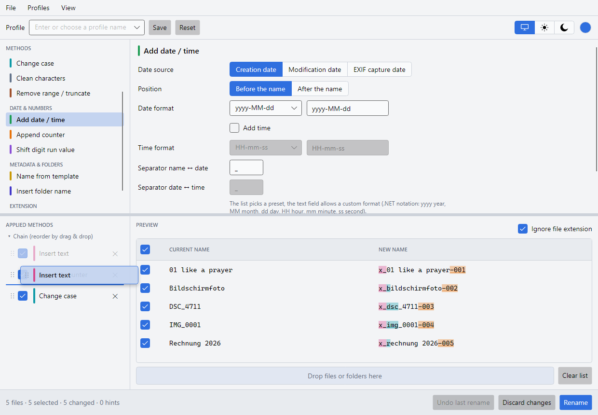
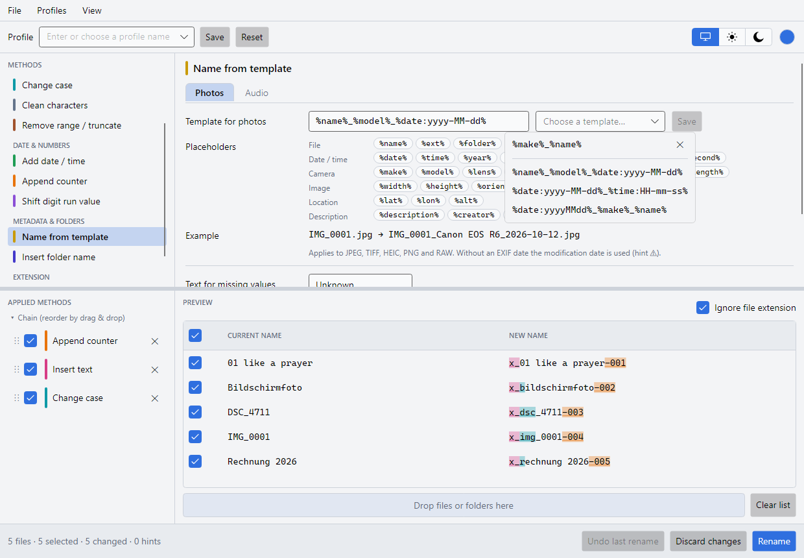
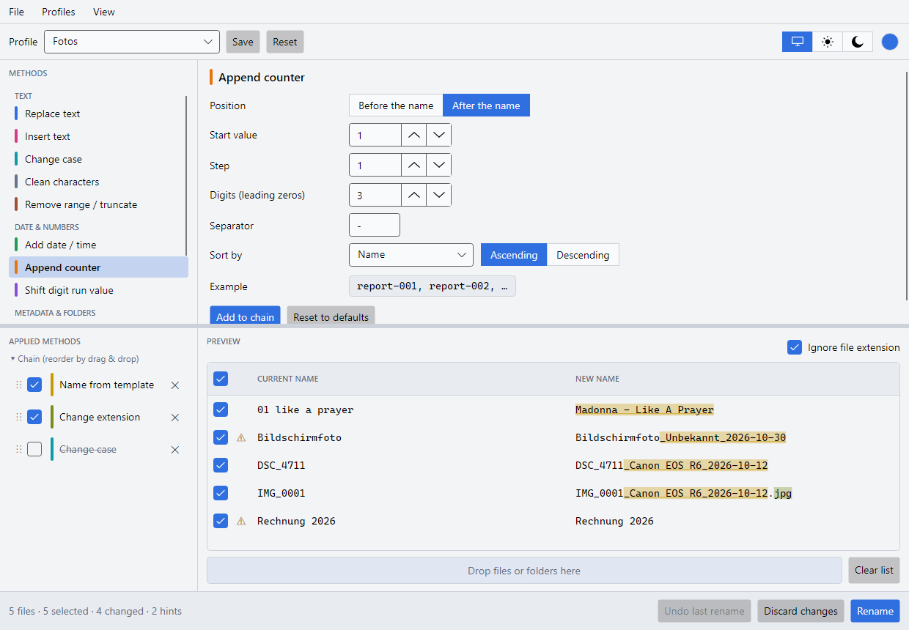
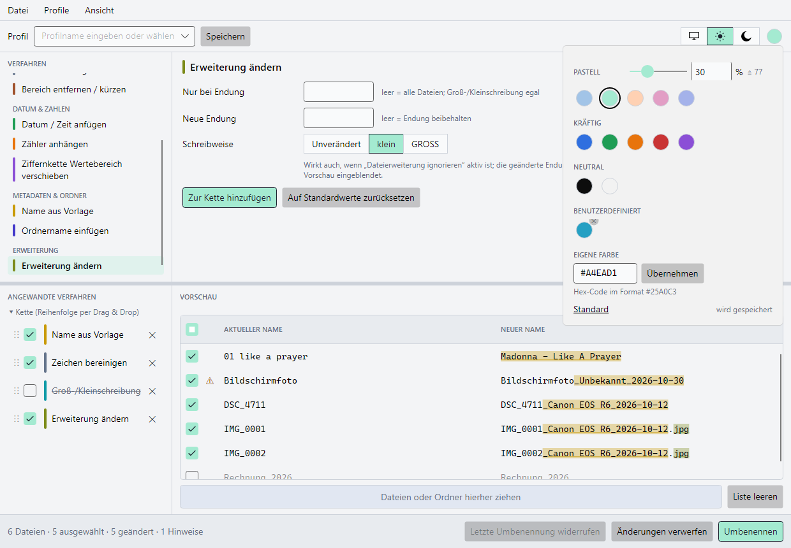

# FileRenamer – Anwenderdokumentation

FileRenamer benennt eine oder viele Dateien auf einmal um. Dazu stellen Sie mehrere Verfahren zu
einer **Kette** zusammen, die nacheinander angewandt werden. Eine Vorschau zeigt jederzeit, wie die
Dateien heißen werden; erst mit **Umbenennen** werden die Dateien tatsächlich geändert.

Unterstützte Systeme: Windows 10/11, Linux, macOS ab Version 14.

## Das Fenster

| Bereich | Funktion |
|---------|----------|
| Menü und Leiste oben | Dateien/Ordner hinzufügen, Profile, Bereich (Umbenennen / Tags), Theme (System, Hell, Dunkel), Akzentfarbe (farbiger Kreis) |
| Oben links: **Verfahren** | Auswahl des Verfahrens, gruppiert in Text, Datum &amp; Zahlen, Metadaten &amp; Ordner, Erweiterung |
| Oben rechts: **Optionen** | Einstellungen des gewählten Verfahrens |
| Unten links: **Angewandte Verfahren** | Die Kette in Anwendungsreihenfolge |
| Unten rechts: **Vorschau** | Aktueller und neuer Name; Änderungen sind in der Farbe des Verfahrens hinterlegt |
| Fußzeile | Zusammenfassung, „Letzte Umbenennung widerrufen“, „Änderungen verwerfen“, „Umbenennen“ |

## Schritt für Schritt

1. **Dateien hinzufügen:** über *Datei → Dateien hinzufügen…* bzw. *Ordner hinzufügen…* oder per
   Drag &amp; Drop auf das Fenster. Bei Ordnern werden die Dateien direkt darin übernommen, Unterordner nicht.
2. **Verfahren wählen** (oben links) und **Optionen einstellen** (oben rechts).
3. **Zur Kette hinzufügen** klicken. Das Verfahren erscheint unten links und wirkt sofort auf die Vorschau.
4. Weitere Verfahren hinzufügen. Sie werden in der Reihenfolge der Kette angewandt.
5. Vorschau prüfen und **Umbenennen** klicken. Nach der Sicherheitsabfrage werden die Dateien umbenannt.

## Die Kette bearbeiten

- **Eintrag anklicken:** Die Optionen erscheinen oben rechts; jede Änderung wirkt sofort.
  „Zur Kette hinzufügen“ legt in diesem Fall eine Kopie an.
- **Checkbox:** schaltet ein Verfahren in der Vorschau aus und wieder ein (Rückgängig pro Verfahren).
- **✕:** entfernt das Verfahren aus der Kette.
- **⋮⋮ ziehen:** ändert die Reihenfolge. Ein Abbild des Eintrags hängt am Mauszeiger, der Eintrag selbst
  bleibt blass an seinem Platz. Eine farbige Linie zeigt, wo er beim Loslassen eingefügt wird.

  
- **Rot umrandeter Eintrag:** Das Verfahren ist so nicht anwendbar; der Tooltip nennt den Grund.

Dasselbe Verfahren darf mehrfach in der Kette vorkommen. Die farbige Markierung des gerade gewählten
Ketteneintrags hat in der Vorschau Vorrang, wenn sich Änderungen überschneiden.

## Die Verfahren

### Text ersetzen
Sucht einen Text und ersetzt den **ersten**, **letzten** oder **alle** Treffer. Groß-/Kleinschreibung
wird beachtet. Mit **Regulärer Ausdruck** sind Muster möglich, z. B. `(\d{4})-(\d{2})` → `$2.$1`.

### Datum / Zeit anfügen
Fügt das **Erstellungs-**, **Änderungs-** oder **EXIF-Aufnahmedatum** vor oder nach dem Namen ein, optional mit Uhrzeit.
Beim EXIF-Aufnahmedatum gilt: Aufnahmedatum, ersatzweise Digitalisierungsdatum, dann EXIF-Änderungsdatum;
ohne EXIF-Datum wird das Änderungsdatum der Datei verwendet (⚠).
Das Format wählen Sie aus der Liste oder geben es selbst ein (`yyyy` Jahr, `MM` Monat, `dd` Tag,
`HH` Stunde, `mm` Minute, `ss` Sekunde). Ungültige Formate, z. B. mit Doppelpunkt, werden rot gemeldet.
Beide Trennzeichen (Name ↔ Datum, Datum ↔ Uhrzeit) sind frei wählbar.
Ist kein Erstellungsdatum verfügbar (häufig unter Linux), wird das Änderungsdatum verwendet und die
Zeile mit ⚠ markiert.

### Zähler anhängen
Hängt eine fortlaufende Nummer vor oder nach dem Namen an. Einstellbar sind Startwert, Schrittweite,
Stellen (führende Nullen), Trennzeichen sowie die Sortierung (Name, Erstellungsdatum, Änderungsdatum,
Größe; auf- oder absteigend). Namen werden „natürlich“ sortiert: `datei2` kommt vor `datei10`.

### Ziffernkette Wertebereich verschieben
Addiert einen Wert (auch negativ) auf eine Zahl im Namen, z. B. `name-001` + 100 → `name-101`.
Standardmäßig wird die **letzte** Ziffernkette verwendet. Ohne Haken bei „Letzte gefundene“ wählen
Sie die Nummer von links (z. B. Nr. 2 bei `name-301-001`). Erlaubt sind nur Nummern, die alle Dateien
mit Ziffernketten besitzen; das Feld zeigt den gültigen Bereich.
Die ursprüngliche Breite bleibt standardmäßig erhalten (`001` → `011`), alternativ legen Sie die
Mindeststellen fest. Wird eine Zahl größer, wächst sie mit (`995` + 10 → `1005`).
Namen ohne Ziffernkette bleiben unverändert (⚠); ein negatives Ergebnis ist ein Konflikt (⛔).

### Text einfügen
Fügt Text an einer Position ein, gezählt ab 0 vom Anfang oder (Haken) vom Ende. Liegt die Position
hinter dem Namensende, wird am Ende eingefügt.

### Groß-/Kleinschreibung
Wählt eine Schreibweise; die Auswahlliste zeigt zu jeder ein Beispiel:

| Schreibweise | `mein Urlaub-Foto_2026` wird zu |
|---|---|
| kleinschreibung | `mein urlaub-foto_2026` |
| GROSSSCHREIBUNG | `MEIN URLAUB-FOTO_2026` |
| Erster buchstabe groß | `Mein urlaub-foto_2026` |
| Jedes Wort Groß | `Mein Urlaub-Foto_2026` |
| PascalCase | `MeinUrlaubFoto2026` |
| camelCase | `meinUrlaubFoto2026` |
| snake_case | `mein_urlaub_foto_2026` |
| kebab-case | `mein-urlaub-foto-2026` |

Wortgrenzen sind Leerzeichen, `_`, `-`, `.` und der Wechsel von klein zu GROSS (`meinBild` → mein, Bild).
Ziffern bleiben am Wort; ß bleibt beim Großschreiben ß.

### Zeichen bereinigen
Entfernt Leerzeichen am Anfang und Ende, fasst mehrfache Leerzeichen zusammen, schreibt Umlaute um
(ä→ae, ö→oe, ü→ue, ß→ss) und entfernt Akzente (é→e). Jede Option lässt sich einzeln abwählen.
Beispiel: `␣␣Café␣␣␣Müller␣` → `Cafe Mueller`.

### Bereich entfernen / kürzen
- **Zeichen entfernen:** eine Anzahl Zeichen ab einer Position (ab 0, vom Anfang oder vom Ende) löschen,
  z. B. 4 Zeichen ab 0: `IMG_0001` → `0001`.
- **Auf Länge kürzen:** Namen, die länger als die Höchstlänge sind, werden am Ende abgeschnitten.

### Name aus Vorlage
Baut den Namen aus einer Vorlage mit Platzhaltern; `%name%` steht für den bisherigen Namen. Die Optionen
haben zwei Tabs mit je einer eigenen Vorlage. Der aktive Tab ist farbig hinterlegt – kräftig in der
Akzentfarbe, solange Sie im Editor arbeiten, sonst blasser:

- **Fotos** (JPEG, TIFF, HEIC, PNG, RAW: DNG, CR2, CR3, NEF, ARW, ORF, RW2, RAF, PEF), z. B.
  `%name%_%model%_%date:yyyy-MM-dd%` → `IMG_0001_Canon EOS R6_2026-10-12`
- **Audio** (MP3 mit ID3, FLAC, M4A), z. B. `%artist% - %title%` → `Madonna - Like A Prayer`

Andere Dateien (z. B. PDF) bleiben unverändert (⚠). Eine leere Vorlage lässt die Dateien dieses Typs unverändert.

| Gruppe | Platzhalter |
|---|---|
| Datei (beide Tabs) | `%name%` `%ext%` `%folder%` |
| Datum / Zeit | `%date%` `%time%` `%year%` `%month%` `%day%` `%hour%` `%minute%` `%second%` |
| Kamera | `%make%` `%model%` `%lens%` `%iso%` `%fnumber%` (f4) `%exposure%` (1-250s) `%focallength%` (50mm) |
| Bild | `%width%` `%height%` `%orientation%` (0/90/180/270) |
| Ort | `%lat%` (48.13743N) `%lon%` (11.57549E) `%alt%` (519m) |
| Beschreibung | `%description%` `%creator%` `%copyright%` (aus EXIF, sonst IPTC, sonst XMP) |
| Audio: Titel | `%artist%` `%title%` `%album%` `%albumartist%` `%composer%` `%genre%` |
| Audio: Nummerierung | `%track%` `%disc%` `%year%` |

- **Platzhalter einfügen:** Ein Klick auf einen Platzhalter fügt ihn an der Cursorposition ein.
- **Vorlage wählen:** Die Liste neben dem Vorlagenfeld übernimmt eine Vorlage ins Feld. Oben stehen Ihre
  eigenen Vorlagen (neueste zuerst), unter der Linie die Beispielvorlagen.
- **Eigene Vorlage speichern:** „Speichern“ nimmt die eingegebene Vorlage in die Liste des Tabs auf. Die
  Schaltfläche ist nur aktiv, wenn die Vorlage fehlerfrei und noch nicht in der Liste ist. Je Tab werden
  höchstens 10 eigene Vorlagen gemerkt; beim Speichern einer weiteren entfällt die älteste. Eigene Vorlagen
  gelten für alle Profile und bleiben nach dem Beenden erhalten. **✕** in der Liste entfernt eine eigene Vorlage.

  
- **Format:** `%date:dd.MM.yyyy%` bzw. `%time:HH-mm%` legen das Datumsformat fest; `%track:000%` die Stellenzahl.
  Standardmäßig hat `%track%` so viele Stellen wie unter „Stellen der Tracknummer“ eingestellt (2 → `03`).
- **Fehlende Werte** werden durch den Ersatztext ersetzt (Standard „Unbekannt“, ⚠). Fehlt das EXIF-Datum,
  verwenden die Datumsplatzhalter das Änderungsdatum der Datei (⚠).
- **Verbotene Zeichen** in Werten werden durch das Ersatzzeichen ersetzt (Standard `_`): `AC/DC` → `AC_DC`.
- **Tippfehler** wie `%artis%` markieren das Verfahren als fehlerhaft; Umbenennen ist dann gesperrt.

### Ordnername einfügen
Fügt den Namen des Ordners vor oder nach dem Namen ein. Ebene 1 ist der Ordner der Datei, Ebene 2 der
darüber usw. Beispiel: `Reisen\Urlaub 2026\IMG_0001` → `Urlaub 2026_IMG_0001`.

### Erweiterung ändern
Ändert die Endung: nur bei einer bestimmten Endung (leer = alle), auf eine neue Endung (leer = beibehalten)
und in einer Schreibweise (unverändert, klein, GROSS). Beispiel: `Foto.JPEG` → `Foto.jpg`.
Das Verfahren wirkt auch, wenn „Dateierweiterung ignorieren“ aktiv ist; die geänderte Endung wird dann in
der Vorschau eingeblendet.

## Dateien auswählen

Jede Zeile der Vorschau hat eine Checkbox. Umbenannt werden nur **ausgewählte** Dateien.

- Abgewählte Dateien werden ausgegraut und behalten ihren Namen. Sie durchlaufen die Kette nicht:
  Der Zähler nummeriert nur die ausgewählten Dateien lückenlos, und die erlaubte Ziffernketten-Nr.
  richtet sich nur nach ihnen.
- Der Name einer abgewählten Datei bleibt belegt. Würde eine ausgewählte Datei genauso heißen, ist das ein Konflikt.
- Die Checkbox im Spaltenkopf wählt alle bzw. keine Datei aus. Bei teilweiser Auswahl zeigt sie einen Zwischenzustand.
- Neu hinzugefügte Dateien sind ausgewählt.

## Spalten anpassen

In beiden Vorschaulisten (Umbenennen und Tags) lassen sich die Spalten anpassen; Checkbox und ⚠ bleiben vorne.

- **Breite:** die rechte Kante eines Spaltenkopfs ziehen (der Mauszeiger wird zum Doppelpfeil). Ein Doppelklick auf
  die Kante passt die Breite an den längsten sichtbaren Eintrag an.
- **Reihenfolge:** einen Spaltenkopf an eine andere Stelle ziehen; eine Linie in der Akzentfarbe zeigt die Einfügestelle.
- **Rechtsklick auf die Spaltenköpfe:**
  - *Reihenfolge und Breiten speichern* – gilt auch nach einem Neustart (programmweit, je Liste).
  - *Gespeicherte Anordnung wiederherstellen* – verwirft ungespeicherte Änderungen.
  - *Auf Standard zurücksetzen* – Werkseinstellung; eine gespeicherte Anordnung bleibt erhalten, bis Sie erneut speichern.

Ungespeicherte Änderungen gelten bis zum Programmende.

Sind die Spalten zusammen breiter als die Liste (z. B. nach dem Verbreitern einer Spalte oder bei schmalem Fenster),
lässt sich die Liste **horizontal scrollen** (Bildlaufleiste unten oder Umschalt+Mausrad); die Spaltenköpfe laufen mit.
Flexible Spalten werden dabei nicht schmaler als ihre Mindestbreite.

## Namen kopieren

Die Namen in der Vorschau lassen sich in die Zwischenablage kopieren.

- **Text markieren:** Mit der Maus über einen Namen ziehen (Doppelklick markiert ein Wort) und **Strg+C**
  (macOS: Cmd+C) drücken oder per Rechtsklick *Markierten Text kopieren* wählen.
- **Zeilen markieren:** Eine Zeile anklicken; mit **Strg** (macOS: Cmd) kommen weitere Zeilen hinzu oder fallen weg,
  mit **Umschalt** wird ein Bereich markiert. Markierte Zeilen sind farbig hinterlegt, markierte Konfliktzeilen
  erhalten einen Rahmen in der Akzentfarbe.
- **Zeilen kopieren:** Rechtsklick und *Aktuelle Namen kopieren*, *Neue Namen kopieren* oder *Aktuelle und neue Namen
  kopieren* wählen. Je Datei entsteht eine Zeile; bei beiden Namen sind sie durch einen Tabulator getrennt und lassen
  sich so direkt in eine Tabellenkalkulation einfügen. **Strg+C** ohne markierten Text kopiert die neuen Namen.
- Kopiert wird, was angezeigt wird: Bei *Dateierweiterung ignorieren* also ohne Endung.
- Das Markieren einer Zeile ist unabhängig von ihrer Checkbox – es entscheidet nicht, welche Dateien umbenannt werden.

## Audiodateien taggen

Der Umschalter rechts in der Leiste (links neben der Theme-Auswahl) wechselt zwischen den Bereichen:
**Umbenennen** („T“ mit Pfeil, Strg+1) und **Tags** (Etikett, Strg+2); ebenso *Ansicht → Bereich*. Ist genug Platz,
steht neben dem Symbol auch die Beschriftung, sonst nur das Symbol mit Tooltip. Beide Bereiche nutzen dieselbe
Dateiliste. Im Bereich Tags sind Profilfeld, „Speichern“ und „Zurücksetzen“ ausgeblendet – Profile gelten nur für das
Umbenennen.

Unterstützt werden alle Audioformate, die die Bibliothek TagLib# schreiben kann, u. a. MP3, FLAC, M4A, OGG, Opus,
WMA, WAV und AIFF. MP3 wird als ID3v2.3 geschrieben. Andere Dateien erscheinen ausgegraut („keine Audiodatei –
wird übersprungen“).

### Aufbau

| Bereich | Funktion |
|---------|----------|
| Oben links: **Funktionen** | Tags bearbeiten, Tags aus Dateinamen, Tracknummern vergeben, Cover, Lyrics |
| Oben rechts: **Optionen** | Einstellungen der gewählten Funktion; daneben die ausgewählte Datei bzw. „n Dateien ausgewählt“ |
| Unten links: **Vorgemerkte Änderungen** | Werden erst mit „Tags speichern“ geschrieben; Checkbox schaltet eine Änderung in der Vorschau aus, ✕ entfernt sie |
| Unten rechts: **Tag-Vorschau** | Checkbox zur Dateiauswahl; Track, Titel, Interpret, Album, Albuminterpret, Jahr, Cover und Lyrics nach den Änderungen, farbig in der Farbe der Funktion |
| Fußzeile | Zusammenfassung, „Letzte Speicherung widerrufen“, „Änderungen verwerfen“, „Tags speichern“ |

### So gehen Sie vor

1. **Dateien auswählen:** Wie beim Umbenennen hat jede Zeile eine Checkbox; die Funktionen arbeiten mit den
   **ausgewählten** Dateien. Die Checkbox im Spaltenkopf wählt alle bzw. keine Audiodatei aus. Andere Dateien sind
   ausgegraut, ihre Checkbox ist gesperrt. Beim Öffnen ist die erste Audiodatei ausgewählt.
2. **Funktion wählen** und Einstellungen vornehmen.
3. **Änderungen vormerken.** Die Änderung erscheint unten links, die Vorschau zeigt das Ergebnis.
   Mit *Vorher anzeigen* sehen Sie die bisherigen Werte durchgestrichen davor; reicht der Platz nicht, wird der
   bisherige Wert gekürzt (…), der neue bleibt vollständig sichtbar. Der Tooltip zeigt den bisherigen Wert ebenfalls.
4. **Tags speichern** (bzw. Strg+Umschalt+S). Nach einer Sicherheitsabfrage werden die Dateien geschrieben –
   **alles oder nichts**: Schlägt eine Datei fehl, werden die bereits geschriebenen zurückgesetzt.

Dateien und Ordner nehmen Sie per Drag & Drop an einer beliebigen Stelle des Fensters an; ist die Liste leer, steht
der Hinweis dazu in der Liste. **Liste leeren** rechts über der Tag-Vorschau entfernt alle Dateien aus der
(gemeinsamen) Liste. Sind Tag-Änderungen vorgemerkt, fragt das
Programm vorher nach – beim Leeren werden sie verworfen. Das gilt auch für **Liste leeren** im Bereich „Umbenennen“
und im Menü *Datei*.

**Kopieren aus der Tag-Vorschau:** Text in einer Zelle lässt sich mit der Maus markieren und mit Strg+C kopieren.
Zeilen markieren Sie wie in der Rename-Liste per Klick (Strg/Umschalt für mehrere, Strg+A für alle) – das ist
unabhängig von der Checkbox. Das Kontextmenü der markierten Zeilen bietet *Dateinamen kopieren*, *Tags kopieren*, *Dateinamen und Tags kopieren*
und *Zeilen kopieren* (mit Kopfzeile). Strg+C ohne markierten Text entspricht *Zeilen kopieren*. Spalten sind durch
Tabulatoren getrennt (passend zum Einfügen in eine Tabellenkalkulation), leere Werte bleiben leer, Cover und Lyrics
erscheinen als „ja“. Kopiert wird immer der **gespeicherte Stand** der Dateien – vorgemerkte Änderungen nicht.

Jede vorgemerkte Änderung gilt für die Dateien, für die sie vorgemerkt wurde. Spätere Änderungen haben Vorrang.
Ein Klick auf eine vorgemerkte Änderung (nicht auf Checkbox oder ✕) wählt ihre Dateien aus (Checkboxen) und öffnet ihre Funktion – auch
wiederholt; bearbeiten lässt sie sich
nicht – entfernen Sie sie mit ✕ und merken Sie sie neu vor. Nach dem Speichern liest das Programm die Tags neu,
sodass *Name aus Vorlage* beim Umbenennen sofort die neuen Werte verwendet.

**Letzte Speicherung widerrufen** stellt Tags, Cover und Lyrics der zuletzt gespeicherten Dateien wieder her
(bis zum Programmende). **Änderungen verwerfen** entfernt alle vorgemerkten Änderungen; die Dateien bleiben unverändert.

### Tags bearbeiten

Das Formular zeigt die Werte der ausgewählten Dateien. Haben sie unterschiedliche Werte, steht dort
*&lt;verschiedene&gt;*; das Feld bleibt dann unverändert, solange Sie es nicht bearbeiten.

- Ein geändertes Feld erhält links einen farbigen Balken; **↺** nimmt die Änderung zurück, *Felder zurücksetzen* alle.
- Ein **geleertes** Feld löscht den Tag. Mehrere Werte (z. B. Interpreten) trennen Sie mit **;**.
- Jahr, Track, Disc und BPM nehmen nur ganze Zahlen an.
- **Genre:** eine Auswahl wie bei den Profilen – Sie können tippen oder mit dem Pfeil die Liste öffnen. Oben stehen Ihre eigenen Genres (neueste zuerst, höchstens 20, ✕ entfernt eines),
  darunter die Standardgenres. Ein neues Genre wird beim Vormerken automatisch aufgenommen.
- **Feld hinzufügen:** ein gängiges Feld aus der Liste wählen (BPM, Copyright, Herausgeber, ISRC, Dirigent,
  Untertitel, Gruppierung, Sortiernamen …) oder einen eigenen Namen eingeben. Hinzugefügte Felder bleiben im Formular,
  auch nach dem Neustart; **✕** blendet ein Feld aus, der Tag bleibt in den Dateien. Gängige Felder, die eine ausgewählte
  Datei enthält, erscheinen automatisch.

### Tags aus Dateinamen

Liest Felder mit einer Vorlage aus dem Dateinamen, z. B. `%track% %title%`: `01 Like A Prayer.mp3` → Track 1,
Titel „Like A Prayer“. Platzhalter: `%artist%` `%title%` `%album%` `%albumartist%` `%track%` `%disc%` `%year%`
`%genre%` `%composer%`; `%skip%` überspringt einen Teil. Mit **/** lesen Sie Ordner mit:
`%artist%/%album%/%track% %title%`. Optional gelten Unterstriche als Leerzeichen. Passt ein Name nicht zur Vorlage,
bleibt die Datei unverändert (⚠).

### Tracknummern vergeben

Nummeriert die Dateien ab dem Startwert – in Listenreihenfolge, nach Dateiname oder nach Titel. Auf Wunsch wird
„von“ auf die Anzahl der Dateien gesetzt (3/12) und die Discnummer mitgesetzt.

### Cover

Die Kacheln zeigen die Bilder der ersten ausgewählten Datei mit Bildtyp, Format, Maßen und Größe; ein Klick wählt ein Bild.

- **Einfügen:** Bei der Quelle *Bilddatei* öffnet *Einfügen…* die Dateiauswahl; alternativ ein Bild auf die
  Ablagefläche ziehen (die ganze Fläche nimmt es an). *Aus dem Ordner*
  nimmt für jede Audiodatei `cover`, `folder` oder `front` (.jpg, .png …) aus ihrem Ordner. Wählbar sind Bildtyp
  (Vorderseite, Rückseite, Booklet-Seite, Medium, Interpret, Band-Logo, Sonstiges) und ob ein Bild desselben Typs
  ersetzt wird.
- **Verkleinern:** Größere Bilder werden auf die eingestellte Pixelzahl der längsten Seite verkleinert (Standard 1000,
  wird gemerkt). JPEG wird mit Qualität 90 % gespeichert, PNG bleibt PNG; kleinere Bilder bleiben unverändert.
- **Gewähltes entfernen** entfernt den Bildtyp der gewählten Kachel aus den Dateien unter *Gilt für*.
- **Extrahieren** speichert die Bilder sofort als Dateien – in den Ordner der Audiodatei oder einen gewählten Ordner.
  Der Dateiname kann `%type%`, `%album%`, `%artist%` und `%name%` enthalten. Vorhandene Dateien werden nie
  überschrieben (dann z. B. `cover (2).jpg`); gleiche Bilder werden auf Wunsch nur einmal gespeichert.

### Lyrics

- **Text:** Bei genau einer ausgewählten Datei lässt sich der Text bearbeiten und mit Sprache *vormerken*.
- **Importieren:** aus der Datei gleichen Namens (`.lrc`, sonst `.txt`) neben jeder Audiodatei oder aus einer
  gewählten Datei (Option *Gewählte Datei*; die Auswahl öffnet sich beim Importieren). Zeitstempel aus LRC-Dateien bleiben als Text erhalten. Dateien ohne Lyrics-Datei bleiben unverändert (⚠).
- **Exportieren:** als `.lrc` (unverändert) oder `.txt` (ohne Zeitstempel) mit dem Namen der Audiodatei, in deren
  Ordner oder einen gewählten Ordner (Option *Gewählter Ordner*; die Auswahl öffnet sich beim Exportieren); vorhandene Dateien nur auf Wunsch überschreiben.

Extrahieren und Exportieren verwenden die Cover und Lyrics, wie sie in den Dateien stehen – noch nicht gespeicherte
Änderungen zählen dabei nicht.

## Dateierweiterung ignorieren

Ist der Haken über der Vorschau gesetzt, wirken die Verfahren nur auf den Namen ohne die **letzte**
Endung (bei `archiv.tar.gz` also ohne `.gz`). Die Endung wird dann auch nicht angezeigt, bleibt beim
Umbenennen aber erhalten.

## Hinweise und Konflikte

| Symbol | Bedeutung |
|--------|-----------|
| ⚠ | Hinweis, z. B. Ausweichen auf Änderungsdatum oder keine Ziffernkette gefunden. Umbenennen ist möglich. |
| ⛔ (rote Zeile) | Konflikt: doppelter Zielname, Name existiert bereits, ungültiger Name (verbotene Zeichen `< > : " / \ | ? *`, reservierte Namen wie `CON`, Punkt/Leerzeichen am Ende, mehr als 255 Zeichen) oder negatives Ergebnis. **Umbenennen ist gesperrt.** |

Fahren Sie mit der Maus über das Symbol, um den Grund zu sehen.

## Umbenennen und Sicherheit

- Vor dem Umbenennen erscheint eine Sicherheitsabfrage.
- Es wird immer **alles oder nichts** umbenannt: Tritt ein Fehler auf (z. B. Datei gesperrt), werden
  alle bereits umbenannten Dateien wieder zurückbenannt.
- Tauschen von Namen (a ↔ b) und reine Änderungen der Groß-/Kleinschreibung funktionieren.
- Nach dem Umbenennen bleibt die Kette erhalten; die Liste zeigt die neuen Namen.
- **Letzte Umbenennung widerrufen** gibt den zuletzt umbenannten Dateien nach einer Sicherheitsabfrage ihre
  vorherigen Namen zurück (ebenfalls alles oder nichts). Ist ein früherer Name inzwischen belegt, wird nichts geändert.
- **Änderungen verwerfen** leert die Kette; die Dateien bleiben in der Liste.
- **Liste leeren** (rechts über der Vorschau oder *Datei → Liste leeren*) entfernt alle Dateien aus der Liste – die Dateien selbst bleiben unverändert.

## Profile

Ein Profil speichert die Kette mit allen Einstellungen und der Reihenfolge sowie „Dateierweiterung ignorieren“.

- **Speichern** (Leiste) bzw. *Profile → Profil speichern…* öffnet immer den Dialog „Profil speichern“.
  Er ist mit dem Namen aus dem Profilfeld vorbelegt. Ein neuer Name legt ein weiteres Profil an,
  ein vorhandener Name wird nach Rückfrage überschrieben.
- Im Profilfeld können Sie einen Namen direkt eintippen; Eintippen allein lädt nichts.
- **Laden:** ein Profil in der aufgeklappten Liste wählen (oder *Profile → Profil laden…*).
- *Profile → Profil löschen…* entfernt das aktuelle Profil.
- **Zurücksetzen** (Leiste, neben „Speichern“) bzw. *Profile → Profil zurücksetzen* entfernt alle Verfahren
  aus der Kette und leert das Profilfeld. Enthält die Kette Verfahren, wird vorher nachgefragt.
  Gespeicherte Profile bleiben in der Liste und können weiter gewählt werden; Dateiliste und
  „Dateierweiterung ignorieren“ bleiben unverändert.

Das zuletzt verwendete Profil, das Theme, die Akzentfarbe und die Sprache werden beim nächsten Start wiederhergestellt.

## Sprache

Unter *Ansicht → Sprache* (*View → Language*) wählen Sie:

- **System:** Deutsch, wenn das Betriebssystem auf Deutsch eingestellt ist, sonst Englisch (Standard).
- **Deutsch** bzw. **English:** feste Sprache.

Der Wechsel wirkt sofort ohne Neustart; Kette, Dateien und Einstellungen bleiben erhalten. Übersetzt werden alle
Beschriftungen, Hinweise, Konfliktmeldungen und Dialoge. Platzhalter wie `%artist%` sind in beiden Sprachen gleich.
Der Ersatztext für fehlende Werte neuer Vorlagen lautet „Unbekannt“ bzw. „Unknown“; in gespeicherten Profilen
bleibt der gespeicherte Text.

## Theme

Die drei Symbole oben rechts (bzw. *Ansicht*) wählen **System** (Monitor), **Hell** (Sonne) oder **Dunkel** (Mond).

Dialoge (Rückfragen, Meldungen, Eingaben) heben sich in beiden Themes vom Hauptfenster ab: eigene Fläche mit Rahmen;
das Hauptfenster wird abgedunkelt, solange ein Dialog oder eine Datei- bzw.
Ordnerauswahl offen ist.

## Akzentfarbe

Der farbige Kreis rechts neben den Theme-Symbolen (bzw. *Ansicht → Akzentfarbe…*) öffnet die Farbwahl.
Die Akzentfarbe gilt für Schaltflächen, Checkboxen, die Theme-Auswahl, die Hervorhebung gewählter Einträge und
den Hintergrund von markiertem Text. Markierter Text erscheint auf hellen Akzentfarben dunkel, auf dunklen hell.

- **Pastell:** fünf Pastellfarben; der Regler daneben stellt ihre Sättigung nach dem HSV-Prinzip ein
  (10–90 %, Standard 30 %; die Zahl daneben zeigt den Wert auf der Skala bis 255).
- **Kräftig:** Blau (Standard), Grün, Orange, Rot, Violett.
- **Neutral:** 95 % Schwarz, 95 % Weiß.
- **Eigene Farbe:** Hex-Code im Format `#25A0C3` eingeben und „Übernehmen“. Die Farbe erscheint unter
  **Benutzerdefiniert** (höchstens 10; bei mehr fällt die älteste weg). Beim Überfahren entfernt ✕ eine Farbe.
- **Standard** setzt auf das bisherige Blau zurück.

Die Schrift auf akzentfarbigen Flächen wird automatisch hell oder dunkel gewählt. Hebt sich die Farbe kaum
vom Hintergrund ab (z. B. 95 % Weiß im hellen Theme), erhalten Schaltflächen einen Rahmen.

