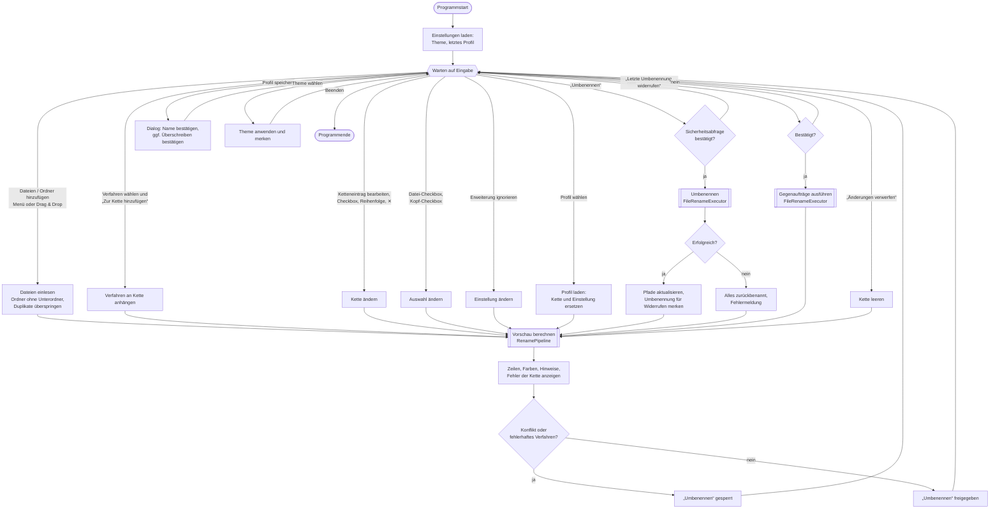
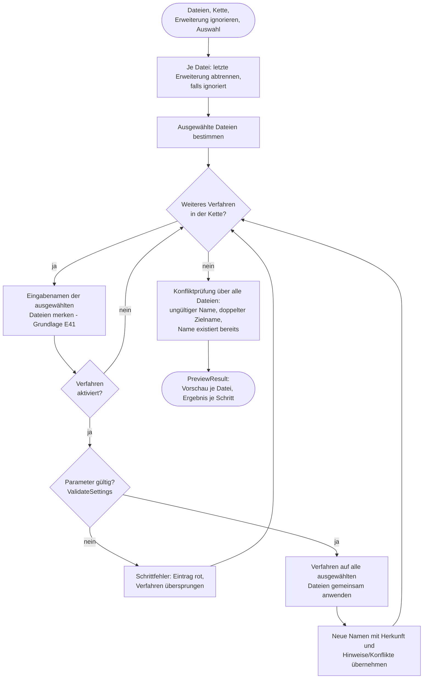

# FileRenamer – Entwicklerdokumentation

## Überblick

FileRenamer ist eine plattformübergreifende Desktopanwendung (Windows, Linux, macOS ab 14) zum
kaskadierenden Umbenennen von Dateien. Technik: **.NET 10 (LTS)**, **Avalonia 12.1.4**,
**CommunityToolkit.Mvvm 8.4.2**; Tests mit **xUnit v3 4.0.2**. Weitere Abhängigkeiten gibt es nicht.

## Voraussetzungen und Befehle

- .NET SDK 10.0 (siehe `global.json`, dort ist auch die Microsoft Testing Platform für `dotnet test` aktiviert)

```bash
dotnet build
```

```bash
dotnet test --project tests/FileRenamer.Core.Tests
```

```bash
dotnet run --project src/FileRenamer.App
```

Veröffentlichen (Beispiel Windows x64, eigenständig):

```bash
dotnet publish src/FileRenamer.App -c Release -r win-x64 --self-contained
```

Für Linux `-r linux-x64`, für macOS `-r osx-arm64` bzw. `-r osx-x64`. Ein macOS-App-Bundle
(`.app` mit `Info.plist`, `LSMinimumSystemVersion` = `14.0`) ist noch nicht Teil des Projekts.

## Projektstruktur

| Pfad | Inhalt |
|------|--------|
| `src/FileRenamer.Core` | Gesamte Fachlogik ohne Oberflächenabhängigkeit |
| `src/FileRenamer.App` | Avalonia-Oberfläche (Views, ViewModels, Dienste) |
| `tests/FileRenamer.Core.Tests` | Unit- und Integrationstests |
| `testdata/` | Testdateien je Verfahren (siehe `testdata/README.md`) |
| `mockups/` | HTML-Mockups; `mockup-v3.html` ist abgenommen |
| `PROTOKOLL.md` | Entscheidungen, Fragen, Fortschritt |

### Projektbaum

Ohne Build-Ordner (`bin/`, `obj/`) und ohne lokale Kopien der Testdaten.

```text
FileRenamer/
├── FileRenamer.slnx                     Projektmappe
├── Directory.Build.props                gemeinsame Einstellungen (net10.0, Nullable, LangVersion)
├── global.json                          dotnet test über Microsoft Testing Platform
├── SPECS.md                             Spezifikation (unverändert)
├── CLAUDE.md                            Arbeitsregeln
├── PROTOKOLL.md                         Fragen, Entscheidungen, Fortschritt
├── ABNAHME.md                           Abnahmeprotokoll
├── docs/
│   ├── ENTWICKLER.md                    diese Datei
│   └── ANWENDER.md                      Anwenderdokumentation
├── mockups/
│   ├── mockup-v1.html … mockup-v3.html  Gestaltungsentwürfe (v3 abgenommen)
│   └── icon-vorschlaege.png             Icon-Entwürfe A–C (C gewählt)
├── src/
│   ├── FileRenamer.Core/                Fachlogik, keine UI-Abhängigkeit
│   │   ├── FileRenamer.Core.csproj
│   │   ├── Execution/
│   │   │   └── FileRenameExecutor.cs    RenameOperation, RenameExecutionResult, zweiphasiges Umbenennen
│   │   ├── Files/
│   │   │   ├── FileEntry.cs             Datei mit Metadaten
│   │   │   ├── IFileSystem.cs           Abstraktion für Tests
│   │   │   └── PhysicalFileSystem.cs    echtes Dateisystem
│   │   ├── Naming/
│   │   │   ├── NameSegment.cs           Abschnitt mit Herkunft
│   │   │   ├── SegmentedName.cs         Name aus Abschnitten
│   │   │   └── NaturalStringComparer.cs natürliche Sortierung
│   │   ├── Preview/
│   │   │   ├── RenamePipeline.cs        wendet die Kette an
│   │   │   ├── ConflictDetector.cs      Konfliktprüfung
│   │   │   ├── FilePreview.cs           Ergebnis je Datei
│   │   │   └── PreviewResult.cs         Gesamtergebnis, RuleStepResult
│   │   ├── Profiles/
│   │   │   ├── RenameProfile.cs         Profil (Kette + Erweiterungseinstellung)
│   │   │   ├── ProfileStore.cs          Profile als JSON
│   │   │   ├── AppSettings.cs           Theme, letztes Profil, AppSettingsStore
│   │   │   ├── AppDataLocator.cs        Ablageorte je Plattform
│   │   │   └── JsonFileStore.cs         gemeinsame JSON-Hilfen
│   │   ├── Rules/
│   │   │   ├── RenameRule.cs            Basis + PerFileRenameRule
│   │   │   ├── ReplaceTextRule.cs       Text ersetzen
│   │   │   ├── AppendDateRule.cs        Datum / Zeit anfügen
│   │   │   ├── AppendCounterRule.cs     Zähler anhängen
│   │   │   ├── ShiftDigitRangeRule.cs   Ziffernkette Wertebereich verschieben
│   │   │   ├── InsertTextRule.cs        Text einfügen
│   │   │   ├── Affix.cs                 Zusatz vor/nach dem Namen
│   │   │   ├── RenameIssue.cs           Hinweis/Konflikt
│   │   │   ├── RuleInput.cs             RuleInput, RuleOutput
│   │   │   └── RuleOptions.cs           Aufzählungen
│   │   └── Validation/
│   │       ├── FileNameValidator.cs     gültige Dateinamen
│   │       └── DateFormatValidator.cs   Datums-/Uhrzeitformate
│   └── FileRenamer.App/                 Avalonia-Oberfläche
│       ├── FileRenamer.App.csproj
│       ├── Program.cs                   Einstiegspunkt
│       ├── App.axaml(.cs)               Ressourcen, Theme-Farben, Start
│       ├── app.manifest
│       ├── Assets/
│       │   ├── app.ico                  Programmsymbol (16–256 px)
│       │   └── app.png                  Fenstersymbol (512 px)
│       ├── Controls/
│       │   ├── HighlightedTextBlock.cs  farbig hervorgehobener Name
│       │   └── RuleColor.cs             Farbklasse je Verfahren
│       ├── Converters/
│       │   └── EnumEqualsConverter.cs   RadioButtons ↔ Aufzählung
│       ├── Services/
│       │   ├── IDialogService.cs        IDialogService, IThemeService
│       │   ├── DialogService.cs         Dialoge, Datei-/Ordnerauswahl
│       │   └── ThemeService.cs          System/Hell/Dunkel
│       ├── ViewModels/
│       │   ├── MainWindowViewModel.cs           Kern: Kette, Vorschau, Umbenennen, Widerrufen
│       │   ├── MainWindowViewModel.Files.cs     Dateien hinzufügen/entfernen
│       │   ├── MainWindowViewModel.Profiles.cs  Profile, Theme
│       │   ├── MainWindowViewModel.Selection.cs Dateiauswahl per Checkbox
│       │   ├── ChainItemViewModel.cs            Eintrag der Kette
│       │   ├── PreviewRowViewModel.cs           Zeile der Vorschau
│       │   ├── RuleCatalog.cs                   Verfahren ↔ Name ↔ Editor
│       │   └── Editors/                         je Verfahren ein Editor + RuleEditorViewModel
│       └── Views/
│           ├── MainWindow.axaml(.cs)            Hauptfenster
│           └── Editors/                         je Verfahren eine Options-Ansicht
├── tests/
│   └── FileRenamer.Core.Tests/
│       ├── FileRenamer.Core.Tests.csproj
│       ├── Execution/       FileRenameExecutorTests.cs
│       ├── Integration/     RenameIntegrationTests.cs (echte Dateien aus testdata/)
│       ├── Naming/          SegmentedNameTests.cs, NaturalStringComparerTests.cs
│       ├── Preview/         RenamePipelineTests.cs
│       ├── Profiles/        ProfileStoreTests.cs
│       ├── Rules/           je Verfahren eine Testklasse
│       ├── Support/         InMemoryFileSystem.cs, RuleTestHelper.cs
│       └── Validation/      FileNameValidatorTests.cs, DateFormatValidatorTests.cs
└── testdata/
    ├── README.md
    ├── 01-text-ersetzen/   02-datum/   03-zaehler/
    └── 04-ziffernkette/    05-text-einfuegen/   06-konflikte/
```

### Core

| Namespace | Verantwortung |
|-----------|---------------|
| `Naming` | `SegmentedName` – unveränderlicher Name aus Abschnitten mit Herkunft (welches Verfahren welche Zeichen erzeugt hat); `NaturalStringComparer` |
| `Rules` | Basis `RenameRule` und die fünf Verfahren |
| `Preview` | `RenamePipeline` (wendet die Kette an), `ConflictDetector`, Ergebnisobjekte |
| `Validation` | `FileNameValidator` (plattformübergreifend strengste Regeln), `DateFormatValidator` |
| `Execution` | `FileRenameExecutor` – zweiphasiges Umbenennen mit Rücknahme |
| `Files` | `IFileSystem` und `PhysicalFileSystem` |
| `Profiles` | Profile und Einstellungen als JSON, plattformübliche Ablageorte |

### App

| Ordner | Inhalt |
|--------|--------|
| `ViewModels` | `MainWindowViewModel` (aufgeteilt in Kern, `.Files`, `.Profiles`), Ketten- und Vorschauzeilen |
| `ViewModels/Editors` | Ein Options-Editor je Verfahren, gemeinsame Basis `RuleEditorViewModel` |
| `Views` | `MainWindow` und je Verfahren eine Editor-Ansicht |
| `Controls` | `HighlightedTextBlock` (farbige Abschnitte), `RuleColor` (Farbklasse je Verfahren) |
| `Services` | Dialoge/Dateiauswahl (`IDialogService`) und Theme (`IThemeService`) |

## Architektur

### Ablauf

1. Dateien werden als `FileEntry` (Pfad, Erstellungs-/Änderungsdatum, Größe) geladen.
2. `RenamePipeline.CreatePreview` trennt ggf. die letzte Erweiterung ab und wendet die aktivierten
   Verfahren der Reihe nach an – nur auf die ausgewählten Dateien (Parameter `selection`, E52–E54);
   abgewählte behalten ihren Namen, gehen aber in die Konfliktprüfung ein. Jedes Verfahren erhält **alle** Dateien auf einmal (`Apply(IReadOnlyList<RuleInput>)`),
   damit z. B. der Zähler sortieren kann. Verfahren mit ungültigen Parametern werden übersprungen und
   als Schrittfehler gemeldet.
3. Je Schritt werden die Eingabenamen festgehalten (`RuleStepResult.InputNames`). Darauf stützen sich
   die Eingabebegrenzungen der Editoren (z. B. Ziffernketten-Nr., E41).
4. `ConflictDetector` prüft ungültige Namen, doppelte Zielnamen und Kollisionen mit fremden Dateien.
5. `FileRenameExecutor` setzt genau das Vorschauergebnis um (`PreviewResult.CreateOperations()`):
   erst alle Dateien in eindeutige temporäre Namen, dann in die Zielnamen. Schlägt etwas fehl,
   wird das Journal rückwärts abgearbeitet (alles oder nichts).
6. Widerrufen: `RenameExecutionResult.CreateUndoOperations()` liefert die umgekehrten Aufträge der
   zuletzt ausgeführten Umbenennung; sie laufen durch denselben Executor (gleiche Garantien).

## Programmablaufplan

Die Diagramme sind in Mermaid notiert und werden u. a. von GitHub, GitLab und VS Code
(Markdown-Vorschau mit Mermaid-Erweiterung) als Grafik dargestellt.

### Gesamtablauf



### Vorschau berechnen (`RenamePipeline.CreatePreview`)



### Umbenennen und Widerrufen (`FileRenameExecutor.Execute`)


Widerrufen ruft denselben Ablauf mit den umgekehrten Aufträgen auf
(`RenameExecutionResult.CreateUndoOperations()`), deshalb gelten dieselben Garantien.

### Hervorhebung

`SegmentedName.Replace` ordnet neuen Text dem verursachenden Verfahren zu und übernimmt die Herkunft
des ersetzten Textes. `NameSegment.GetHighlightSource(preferred)` liefert das ausgewählte Verfahren,
wenn es beteiligt ist (E5), sonst das zuletzt angewandte. Die Farben liegen als Theme-Ressourcen
`RuleColor.<Art>` und `RuleHighlight.<Art>` in `App.axaml`.

### Verfahren hinzufügen

1. In `RuleOptions.cs` einen Wert in `RuleKind` ergänzen.
2. Neue Klasse in `Core/Rules` von `PerFileRenameRule` (oder `RenameRule`, wenn alle Dateien gemeinsam
   betrachtet werden müssen) ableiten; Parameter als `init`-Eigenschaften, Prüfung in `ValidateSettings`.
3. `[JsonDerivedType]` in `RenameRule` ergänzen (Profile).
4. Editor-ViewModel von `RuleEditorViewModel` ableiten, Editor-Ansicht anlegen, beides in
   `RuleCatalog` und den `DataTemplates` von `MainWindow.axaml` registrieren.
5. Farben `RuleColor.<Art>`/`RuleHighlight.<Art>` und Stil `Border.ruleBar.kind-<Art>` in `App.axaml` ergänzen.
6. Tests in `tests/FileRenamer.Core.Tests/Rules` und ggf. Testdateien in `testdata/` ergänzen.

## Tests

- **Unit-Tests** je Verfahren, für Validierung, Pipeline, Konflikte, Ausführung (mit `InMemoryFileSystem`,
  das gezielt Fehler auslösen kann) und Profile.
- **Integrationstests** (`Integration/RenameIntegrationTests`) kopieren je einen `testdata`-Ordner in ein
  temporäres Verzeichnis, prüfen die Vorschau und anschließend die tatsächlich umbenannten Dateien.
- Die Beispiele aus `SPECS.md` sind als eigene Tests abgebildet (`ShiftDigitRangeRuleTests`).

## Plattformhinweise

- **Erstellungsdatum unter Linux:** .NET liefert dort keinen verlässlichen Wert. `PhysicalFileSystem` meldet
  es daher als nicht verfügbar; die Verfahren weichen mit Hinweis auf das Änderungsdatum aus.
- **Groß-/Kleinschreibung:** Linux gilt als unterscheidend, Windows/macOS nicht (Konfliktprüfung).
- **Ablageorte:** `%APPDATA%\FileRenamer`, `~/.config/FileRenamer`, `~/Library/Application Support/FileRenamer`
  (Profile im Unterordner `profiles`, Einstellungen in `settings.json`).

## Konventionen

- Jede Klasse und jede Methode hat einen deutschsprachigen `<summary>`-Kommentar mit Parametern und Rückgabe.
- Verfahren sind unveränderliche `record`s; Änderungen entstehen per `with` (gleiche `Id`).
- Kurze Methoden, keine Logik im Code-Behind außer reiner Oberflächenmechanik (Drag &amp; Drop,
  Laden eines Profils beim Schließen der Profilliste – damit Eintippen nie ein Profil lädt).
- Hinweis zum Build: Läuft die App, sind ihre DLLs gesperrt und `dotnet build` schlägt mit MSB3027 fehl – App vorher schließen.
