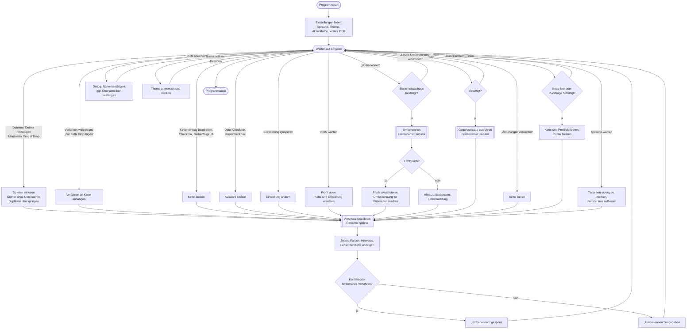
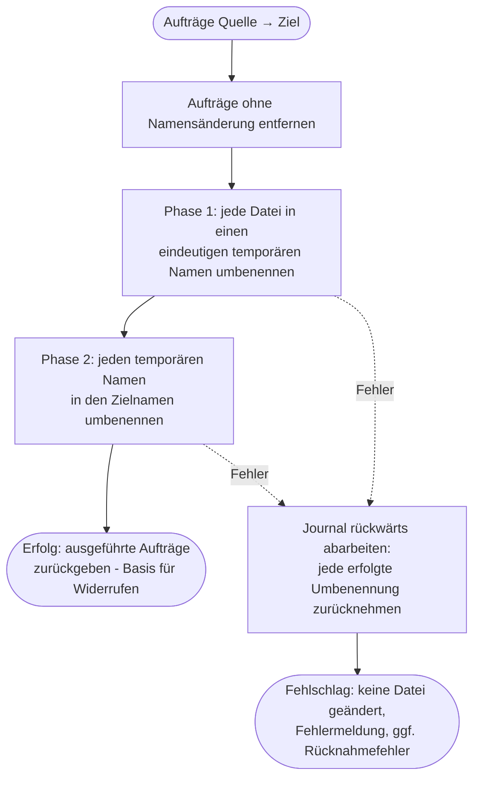

# FileRenamer – Entwicklerdokumentation

## Überblick

FileRenamer ist eine plattformübergreifende Desktopanwendung (Windows, Linux, macOS ab 14) zum
kaskadierenden Umbenennen von Dateien. Technik: **.NET 10 (LTS)**, **Avalonia 12.1.4**,
**CommunityToolkit.Mvvm 8.4.2**; Tests mit **xUnit v3 4.0.2**. Weitere Abhängigkeiten gibt es nicht.

## Voraussetzungen und Befehle

- .NET SDK 10.0 (siehe `global.json`, dort ist auch die Microsoft Testing Platform für `dotnet test` aktiviert)

```bash
dotnet build
```

```bash
dotnet test --project tests/FileRenamer.Core.Tests
```

```bash
dotnet run --project src/FileRenamer.App
```

Veröffentlichen (Beispiel Windows x64, eigenständig):

```bash
dotnet publish src/FileRenamer.App -c Release -r win-x64 --self-contained
```

Für Linux `-r linux-x64`, für macOS `-r osx-arm64` bzw. `-r osx-x64`. Ein macOS-App-Bundle
(`.app` mit `Info.plist`, `LSMinimumSystemVersion` = `14.0`) ist noch nicht Teil des Projekts.

## Projektstruktur

| Pfad | Inhalt |
|------|--------|
| `src/FileRenamer.Core` | Gesamte Fachlogik ohne Oberflächenabhängigkeit |
| `src/FileRenamer.App` | Avalonia-Oberfläche (Views, ViewModels, Dienste) |
| `tests/FileRenamer.Core.Tests` | Unit- und Integrationstests |
| `testdata/` | Testdateien je Verfahren (siehe `testdata/README.md`) |
| `mockups/` | HTML-Mockups; `mockup-v3.html` ist abgenommen |
| `PROTOKOLL.md` | Entscheidungen, Fragen, Fortschritt |

### Projektbaum

Ohne Build-Ordner (`bin/`, `obj/`) und ohne lokale Kopien der Testdaten.

```text
FileRenamer/
├── FileRenamer.slnx                     Projektmappe
├── Directory.Build.props                gemeinsame Einstellungen (net10.0, Nullable, LangVersion)
├── global.json                          dotnet test über Microsoft Testing Platform
├── SPECS.md                             Spezifikation (unverändert)
├── CLAUDE.md                            Arbeitsregeln
├── PROTOKOLL.md                         Fragen, Entscheidungen, Fortschritt
├── ABNAHME.md                           Abnahmeprotokoll
├── docs/
│   ├── ENTWICKLER.md                    diese Datei
│   └── ANWENDER.md                      Anwenderdokumentation
├── mockups/
│   ├── mockup-v1.html … mockup-v3.html  Gestaltungsentwürfe (v3 abgenommen)
│   └── icon-vorschlaege.png             Icon-Entwürfe A–C (C gewählt)
├── src/
│   ├── FileRenamer.Core/                Fachlogik, keine UI-Abhängigkeit
│   │   ├── FileRenamer.Core.csproj
│   │   ├── Execution/
│   │   │   └── FileRenameExecutor.cs    RenameOperation, RenameExecutionResult, zweiphasiges Umbenennen
│   │   ├── Files/
│   │   │   ├── FileEntry.cs             Datei mit Metadaten
│   │   │   ├── IFileSystem.cs           Abstraktion für Tests
│   │   │   └── PhysicalFileSystem.cs    echtes Dateisystem
│   │   ├── Naming/
│   │   │   ├── NameSegment.cs           Abschnitt mit Herkunft
│   │   │   ├── SegmentedName.cs         Name aus Abschnitten
│   │   │   └── NaturalStringComparer.cs natürliche Sortierung
│   │   ├── Preview/
│   │   │   ├── RenamePipeline.cs        wendet die Kette an
│   │   │   ├── ConflictDetector.cs      Konfliktprüfung
│   │   │   ├── FilePreview.cs           Ergebnis je Datei
│   │   │   └── PreviewResult.cs         Gesamtergebnis, RuleStepResult
│   │   ├── Profiles/
│   │   │   ├── RenameProfile.cs         Profil (Kette + Erweiterungseinstellung)
│   │   │   ├── ProfileStore.cs          Profile als JSON
│   │   │   ├── AppSettings.cs           Theme, letztes Profil, Akzentfarbe, Sprache, AppSettingsStore
│   │   │   ├── AppDataLocator.cs        Ablageorte je Plattform
│   │   │   └── JsonFileStore.cs         gemeinsame JSON-Hilfen
│   │   ├── Localization/
│   │   │   └── CoreText.cs              Meldungen der Fachlogik Deutsch/Englisch, Sprachermittlung
│   │   ├── Metadata/
│   │   │   ├── FileMetadata.cs          MediaKind, ImageMetadata, AudioMetadata, FileMetadata
│   │   │   ├── MediaTypes.cs            Endung → Bild/Audio
│   │   │   ├── MetadataReader.cs        Einstieg: passender Leser je Endung, fehlertolerant
│   │   │   └── Readers/
│   │   │       ├── ByteSource.cs        wahlfreies Lesen von Dateiausschnitten
│   │   │       ├── TiffParser.cs        EXIF aus TIFF-Struktur (IFD0, EXIF-, GPS-IFD)
│   │   │       ├── JpegReader.cs        APP1 EXIF/XMP, APP13 IPTC, SOF-Maße
│   │   │       ├── PngReader.cs         IHDR, eXIf, iTXt/tEXt
│   │   │       ├── IsoBox.cs            Boxen des ISOBMFF (HEIC, CR3, M4A)
│   │   │       ├── HeifReader.cs        HEIC/HEIF: iinf/iloc → EXIF-/XMP-Item
│   │   │       ├── RawContainerReader.cs CR3 (CMT1/2/4), RAF (eingebettetes JPEG)
│   │   │       ├── IptcParser.cs, XmpParser.cs  Beschreibung, Ersteller, Copyright
│   │   │       ├── ImageMetadataBuilder.cs      Priorität EXIF → IPTC → XMP → PNG-Text
│   │   │       ├── Id3Reader.cs         ID3v2.2–2.4 und ID3v1
│   │   │       ├── FlacAndMp4Reader.cs  Vorbis Comments (FLAC), iTunes-Atome (M4A)
│   │   │       └── AudioMetadataBuilder.cs      Track „3/12“, Jahr, ID3-Genre-Nummern
│   │   ├── Rules/
│   │   │   ├── RenameRule.cs            Basis + PerFileRenameRule (TargetsExtension)
│   │   │   ├── ReplaceTextRule.cs       Text ersetzen
│   │   │   ├── AppendDateRule.cs        Datum / Zeit anfügen (auch EXIF-Datum)
│   │   │   ├── AppendCounterRule.cs     Zähler anhängen
│   │   │   ├── ShiftDigitRangeRule.cs   Ziffernkette Wertebereich verschieben
│   │   │   ├── InsertTextRule.cs        Text einfügen
│   │   │   ├── ChangeCaseRule.cs        Groß-/Kleinschreibung
│   │   │   ├── CleanCharactersRule.cs   Zeichen bereinigen
│   │   │   ├── RemoveRangeRule.cs       Bereich entfernen / kürzen
│   │   │   ├── TemplateRule.cs          Name aus Vorlage (Fotos/Audio)
│   │   │   ├── InsertFolderRule.cs      Ordnername einfügen
│   │   │   ├── ChangeExtensionRule.cs   Erweiterung ändern (wirkt auf die Endung)
│   │   │   ├── Templates/               TemplateParser, Placeholders (Katalog + Prüfung),
│   │   │   │                            CustomTemplateList (Regeln für eigene Vorlagen, E106)
│   │   │   ├── Affix.cs                 Zusatz vor/nach dem Namen
│   │   │   ├── RenameIssue.cs           Hinweis/Konflikt
│   │   │   ├── RuleInput.cs             RuleInput, RuleOutput
│   │   │   └── RuleOptions.cs           Aufzählungen
│   │   ├── Theming/
│   │   │   └── AccentPalette.cs         Akzentfarben: Paletten, HSV, Kontrast, Benutzerdefiniert
│   │   └── Validation/
│   │       ├── FileNameValidator.cs     gültige Dateinamen
│   │       └── DateFormatValidator.cs   Datums-/Uhrzeitformate
│   └── FileRenamer.App/                 Avalonia-Oberfläche
│       ├── FileRenamer.App.csproj
│       ├── Program.cs                   Einstiegspunkt
│       ├── App.axaml(.cs)               Ressourcen, Theme-Farben, Start, Fensterneuaufbau beim Sprachwechsel
│       ├── app.manifest
│       ├── Assets/
│       │   ├── app.ico                  Programmsymbol (16–256 px)
│       │   └── app.png                  Fenstersymbol (512 px)
│       ├── Controls/
│       │   ├── HighlightedTextBlock.cs  farbig hervorgehobener Name
│       │   └── RuleColor.cs             Farbklasse je Verfahren
│       ├── Converters/
│       │   ├── EnumEqualsConverter.cs   RadioButtons ↔ Aufzählung
│       │   └── HexToBrushConverter.cs   #RRGGBB → Pinsel (Farbflächen)
│       ├── Localization/
│       │   ├── Loc.cs                   Textzugriff (T, F) und XAML-Erweiterung {loc:T Schlüssel}
│       │   └── Strings.cs               alle Oberflächentexte: Schlüssel → (Deutsch, Englisch)
│       ├── Services/
│       │   ├── IDialogService.cs        IDialogService, IThemeService
│       │   ├── DialogService.cs         Dialoge, Datei-/Ordnerauswahl
│       │   └── ThemeService.cs          System/Hell/Dunkel, Akzentfarbe → Fluent-Ressourcen
│       ├── ViewModels/
│       │   ├── MainWindowViewModel.cs           Kern: Kette, Vorschau, Umbenennen, Widerrufen
│       │   ├── MainWindowViewModel.Files.cs     Dateien hinzufügen/entfernen
│       │   ├── MainWindowViewModel.Profiles.cs  Profile (inkl. Zurücksetzen), Theme, Sprache
│       │   ├── MainWindowViewModel.Selection.cs Dateiauswahl per Checkbox
│       │   ├── ChainItemViewModel.cs            Eintrag der Kette
│       │   ├── PreviewRowViewModel.cs           Zeile der Vorschau
│       │   ├── AccentColorViewModel.cs          Akzentfarbwahl, SwatchViewModel
│       │   ├── TemplateLibrary.cs               eigene Vorlagen (Fotos/Audio), programmweit
│       │   ├── RuleCatalog.cs                   gruppierte Verfahrensliste ↔ Name ↔ Editor
│       │   └── Editors/                         je Verfahren ein Editor + RuleEditorViewModel
│       │                                        (einfache Editoren der Erweiterung in SimpleEditors.cs)
│       └── Views/
│           ├── MainWindow.axaml(.cs)            Hauptfenster
│           ├── ChainDragController.cs           Umsortieren der Kette per Drag & Drop
│           ├── AccentPickerView.axaml(.cs)      Farbwahl im Flyout am farbigen Kreis
│           └── Editors/                         je Verfahren eine Options-Ansicht
├── tests/
│   └── FileRenamer.Core.Tests/
│       ├── FileRenamer.Core.Tests.csproj
│       ├── Execution/       FileRenameExecutorTests.cs
│       ├── Integration/     RenameIntegrationTests.cs (echte Dateien aus testdata/ und erzeugte Mediendateien)
│       ├── Localization/    CoreTextTests.cs (Sprachermittlung, Meldungen je Sprache)
│       ├── Metadata/        MetadataReaderTests.cs (alle Bild- und Audioformate)
│       ├── Naming/          SegmentedNameTests.cs, NaturalStringComparerTests.cs
│       ├── Preview/         RenamePipelineTests.cs
│       ├── Profiles/        ProfileStoreTests.cs
│       ├── Rules/           Testklassen der Verfahren, TemplateRuleTests, CustomTemplateListTests, ChangeExtensionRuleTests, TextRulesTests
│       ├── Theming/         AccentPaletteTests.cs
│       ├── Support/         InMemoryFileSystem.cs, RuleTestHelper.cs,
│       │                    MediaFiles.cs + TiffWriter.cs (erzeugen Test-Mediendateien)
│       └── Validation/      FileNameValidatorTests.cs, DateFormatValidatorTests.cs
└── testdata/
    ├── README.md
    ├── 01-text-ersetzen/   02-datum/   03-zaehler/
    └── 04-ziffernkette/    05-text-einfuegen/   06-konflikte/
```

### Core

| Namespace | Verantwortung |
|-----------|---------------|
| `Naming` | `SegmentedName` – unveränderlicher Name aus Abschnitten mit Herkunft (welches Verfahren welche Zeichen erzeugt hat); `NaturalStringComparer` |
| `Rules` | Basis `RenameRule` und die fünf Verfahren |
| `Preview` | `RenamePipeline` (wendet die Kette an), `ConflictDetector`, Ergebnisobjekte |
| `Validation` | `FileNameValidator` (plattformübergreifend strengste Regeln), `DateFormatValidator` |
| `Execution` | `FileRenameExecutor` – zweiphasiges Umbenennen mit Rücknahme |
| `Files` | `IFileSystem` und `PhysicalFileSystem` |
| `Profiles` | Profile und Einstellungen als JSON (inkl. Akzentfarbe), plattformübliche Ablageorte |
| `Metadata` | Eigene Leser für EXIF/IPTC/XMP (JPEG, TIFF, HEIC, PNG, RAW) und Audio-Tags (ID3, FLAC, M4A) – ohne Fremdbibliothek |
| `Rules.Templates` | Platzhalterkatalog und Zerlegung der Vorlagen für „Name aus Vorlage“ |
| `Theming` | `AccentPalette`: Paletten, HSV-Sättigung, lesbare Schriftfarbe, Kontrastprüfung, benutzerdefinierte Farben |
| `Localization` | `CoreText`: alle Meldungen der Fachlogik auf Deutsch und Englisch; `Resolve` ermittelt die Sprache aus der Einstellung |

### App

| Ordner | Inhalt |
|--------|--------|
| `ViewModels` | `MainWindowViewModel` (aufgeteilt in Kern, `.Files`, `.Profiles`), Ketten- und Vorschauzeilen |
| `ViewModels/Editors` | Ein Options-Editor je Verfahren, gemeinsame Basis `RuleEditorViewModel` |
| `Views` | `MainWindow` und je Verfahren eine Editor-Ansicht |
| `Controls` | `HighlightedTextBlock` (farbige Abschnitte), `RuleColor` (Farbklasse je Verfahren) |
| `Services` | Dialoge/Dateiauswahl (`IDialogService`) und Theme (`IThemeService`) |
| `Localization` | `Loc` (Textzugriff), `Strings` (Texte je Sprache), Markup-Erweiterung `TExtension` |

## Architektur

### Ablauf

1. Dateien werden als `FileEntry` (Pfad, Erstellungs-/Änderungsdatum, Größe) geladen.
2. `RenamePipeline.CreatePreview` trennt ggf. die letzte Erweiterung ab und wendet die aktivierten
   Verfahren der Reihe nach an – nur auf die ausgewählten Dateien (Parameter `selection`, E52–E54);
   abgewählte behalten ihren Namen, gehen aber in die Konfliktprüfung ein. Jedes Verfahren erhält **alle** Dateien auf einmal (`Apply(IReadOnlyList<RuleInput>)`),
   damit z. B. der Zähler sortieren kann. Verfahren mit ungültigen Parametern werden übersprungen und
   als Schrittfehler gemeldet.
3. Je Schritt werden die Eingabenamen festgehalten (`RuleStepResult.InputNames`). Darauf stützen sich
   die Eingabebegrenzungen der Editoren (z. B. Ziffernketten-Nr., E41).
4. `ConflictDetector` prüft ungültige Namen, doppelte Zielnamen und Kollisionen mit fremden Dateien.
5. `FileRenameExecutor` setzt genau das Vorschauergebnis um (`PreviewResult.CreateOperations()`):
   erst alle Dateien in eindeutige temporäre Namen, dann in die Zielnamen. Schlägt etwas fehl,
   wird das Journal rückwärts abgearbeitet (alles oder nichts).
6. Widerrufen: `RenameExecutionResult.CreateUndoOperations()` liefert die umgekehrten Aufträge der
   zuletzt ausgeführten Umbenennung; sie laufen durch denselben Executor (gleiche Garantien).

## Programmablaufplan

Die Diagramme sind in Mermaid notiert und werden u. a. von GitHub, GitLab und VS Code
(Markdown-Vorschau mit Mermaid-Erweiterung) als Grafik dargestellt.

### Gesamtablauf



### Vorschau berechnen (`RenamePipeline.CreatePreview`)


### Umbenennen und Widerrufen (`FileRenameExecutor.Execute`)



Widerrufen ruft denselben Ablauf mit den umgekehrten Aufträgen auf
(`RenameExecutionResult.CreateUndoOperations()`), deshalb gelten dieselben Garantien.

### Metadaten

`PhysicalFileSystem.ReadFileEntry` liest beim Hinzufügen einer Datei einmal deren Metadaten
(`FileEntry.Metadata`, E66). `MetadataReader` wählt anhand der Endung den Leser; alle Leser arbeiten über
`ByteSource` und lesen nur die benötigten Bereiche (wichtig bei großen RAW-Dateien). Beschädigte Daten führen
nie zum Abbruch – es fehlen dann lediglich Werte. Reihenfolge der Quellen für Beschreibung, Ersteller und
Copyright: EXIF → IPTC → XMP (→ PNG-Text). Aufnahmedatum: DateTimeOriginal → DateTimeDigitized → DateTime.

| Format | Ort der Daten |
|---|---|
| JPEG | APP1 „Exif“ (TIFF), APP1 XMP, APP13 Photoshop/8BIM 0x0404 (IPTC), SOF (Maße) |
| TIFF, DNG, CR2, NEF, ARW, ORF, RW2, PEF | gesamte Datei ist eine TIFF-Struktur |
| PNG | `eXIf` (TIFF), `iTXt` „XML:com.adobe.xmp“, `tEXt`/`iTXt` (Author, Description, Copyright), `IHDR` |
| HEIC/HEIF | `meta` → `iinf` (Item-Typ „Exif“/„mime“) + `iloc` (Position) |
| CR3 | `moov` → Canon-UUID → `CMT1` (IFD0), `CMT2` (EXIF), `CMT4` (GPS) |
| RAF | Offset (84) und Länge (88) des eingebetteten JPEG |
| MP3 | ID3v2.2/2.3/2.4 am Anfang (inkl. Unsynchronisation), ID3v1 am Ende als Ergänzung |
| FLAC | Metadatenblock 4 (Vorbis Comments) |
| M4A | `moov/udta/meta/ilst` (©ART, ©nam, ©alb, aART, ©wrt, ©gen, ©day, trkn, disk, gnre) |

### Endungen

Verfahren mit `TargetsExtension = true` („Erweiterung ändern“) erhalten von der Pipeline statt des Namens die
Endung inklusive Punkt – die ausgeblendete Endung bzw. bei eingeblendeter Endung den abgetrennten Teil des
Namens (`RenamePipeline.WorkingNames`). Eine geänderte ausgeblendete Endung zeigt die Vorschau an
(`FilePreview.IsExtensionChanged`, E73).

### Akzentfarbe

`AccentPalette` (Core, getestet) berechnet Farben; `ThemeService` schreibt die Akzentfarbe in die
Fluent-Ressourcen (`SystemAccentColor` samt Abstufungen, `AccentButtonForeground*`, `AccentButtonBorderBrush*`,
`CheckBoxCheckGlyphForegroundChecked*`) sowie in eigene Ressourcen (`SelectionBrush`, `AccentForegroundBrush`,
`AccentSegmentBorderBrush`). Bei jedem Theme-Wechsel werden sie neu berechnet, weil Auswahlhintergrund und
Rahmen bei geringem Kontrast vom Fensterhintergrund abhängen. Der Fokusring erscheint in Avalonia nur bei
Tastaturbedienung (E88).

### Sprache

Die Sprache gilt programmweit (`CoreText.Language`, in der App über `Loc.Language` gesetzt). Die Einstellung
(`LanguagePreference` System/Deutsch/English, E92) wird mit `CoreText.Resolve` aufgelöst: „System“ ergibt Deutsch
nur bei deutscher `CultureInfo.CurrentUICulture`, sonst Englisch (E93).

- **Fachlogik:** Alle Meldungen (Hinweise, Konflikte, Prüfungen) liefert `CoreText`; sie werden bei jedem Abruf in
  der aktuellen Sprache erzeugt.
- **Oberfläche:** XAML nutzt `{loc:T Schlüssel}`, C# `Loc.T(...)` bzw. `Loc.F(...)` mit Platzhaltern `{0}`.
  Alle Texte stehen in `Strings.All`. Ein unbekannter Schlüssel erscheint als Schlüssel selbst und fällt so auf.
- **Wechsel ohne Neustart:** `MainWindowViewModel.OnLanguageChanged` setzt die Sprache, erzeugt Editor (mit
  seinen Einstellungen) und Farbwahl neu, berechnet die Vorschau neu, speichert die Einstellung und löst
  `LanguageChanged` aus. `App` baut daraufhin ein neues `MainWindow` mit demselben ViewModel auf (Größe, Lage
  und Zustand bleiben) und setzt `DialogService.Owner` um. Die Verfahrensliste wird nicht per Änderungsmeldung
  erneuert, weil das alte Fenster sonst seine Auswahl auf `null` zurückschreibt; `RuleKindItem` vergleicht
  deshalb nur die Verfahrensart.
- **Neuer Text:** Schlüssel mit beiden Sprachen in `Strings.All` eintragen und per `{loc:T …}` bzw. `Loc.T`
  verwenden.

### Hervorhebung

`SegmentedName.Replace` ordnet neuen Text dem verursachenden Verfahren zu und übernimmt die Herkunft
des ersetzten Textes. `NameSegment.GetHighlightSource(preferred)` liefert das ausgewählte Verfahren,
wenn es beteiligt ist (E5), sonst das zuletzt angewandte. Die Farben liegen als Theme-Ressourcen
`RuleColor.<Art>` und `RuleHighlight.<Art>` in `App.axaml`.

### Verfahren hinzufügen

1. In `RuleOptions.cs` einen Wert in `RuleKind` ergänzen.
2. Neue Klasse in `Core/Rules` von `PerFileRenameRule` (oder `RenameRule`, wenn alle Dateien gemeinsam
   betrachtet werden müssen) ableiten; Parameter als `init`-Eigenschaften, Prüfung in `ValidateSettings`.
3. `[JsonDerivedType]` in `RenameRule` ergänzen (Profile).
4. Editor-ViewModel von `RuleEditorViewModel` ableiten, Editor-Ansicht anlegen, beides in
   `RuleCatalog` und den `DataTemplates` von `MainWindow.axaml` registrieren.
5. Farben `RuleColor.<Art>`/`RuleHighlight.<Art>` und Stil `Border.ruleBar.kind-<Art>` in `App.axaml` ergänzen
   und das Verfahren in `RuleCatalog.Entries` der passenden Gruppe zuordnen.
   Wirkt es auf die Endung, `TargetsExtension` überschreiben.
6. Tests in `tests/FileRenamer.Core.Tests/Rules` und ggf. Testdateien in `testdata/` ergänzen.

## Tests

- **Unit-Tests** je Verfahren, für Validierung, Pipeline, Konflikte, Ausführung (mit `InMemoryFileSystem`,
  das gezielt Fehler auslösen kann) und Profile.
- **Integrationstests** (`Integration/RenameIntegrationTests`) kopieren je einen `testdata`-Ordner in ein
  temporäres Verzeichnis, prüfen die Vorschau und anschließend die tatsächlich umbenannten Dateien.
- Die Beispiele aus `SPECS.md` sind als eigene Tests abgebildet (`ShiftDigitRangeRuleTests`).

## Plattformhinweise

- **Erstellungsdatum unter Linux:** .NET liefert dort keinen verlässlichen Wert. `PhysicalFileSystem` meldet
  es daher als nicht verfügbar; die Verfahren weichen mit Hinweis auf das Änderungsdatum aus.
- **Groß-/Kleinschreibung:** Linux gilt als unterscheidend, Windows/macOS nicht (Konfliktprüfung).
- **Ablageorte:** `%APPDATA%\FileRenamer`, `~/.config/FileRenamer`, `~/Library/Application Support/FileRenamer`
  (Profile im Unterordner `profiles`, Einstellungen in `settings.json`).

## Konventionen

- Jede Klasse und jede Methode hat einen deutschsprachigen `<summary>`-Kommentar mit Parametern und Rückgabe.
- Verfahren sind unveränderliche `record`s; Änderungen entstehen per `with` (gleiche `Id`).
- Kurze Methoden, keine Logik im Code-Behind außer reiner Oberflächenmechanik (Drag &amp; Drop,
  Laden eines Profils beim Schließen der Profilliste – damit Eintippen nie ein Profil lädt).
- Umsortieren der Kette (E102): `Views/ChainDragController` fängt am Griff `⋮⋮` den Mauszeiger ein. Während des
  Ziehens folgt das Abbild `DragGhost` dem Zeiger in der Ebene `DragLayer` (Canvas über dem Fensterinhalt), der
  Ursprungseintrag erhält die Klasse `dragging` (blass), `DropLine` markiert die Einfügestelle. Erst beim Loslassen
  wird `MoveChainItem` aufgerufen; bei Verlust der Mauserfassung wird abgebrochen. `MoveChainItem` stellt die
  Auswahl wieder her, weil die ListBox sie bei `ObservableCollection.Move` verwirft.
- Rahmenfarben von Ketteneinträgen nur per Style setzen: Ein lokal gesetzter Wert hat in Avalonia Vorrang vor
  Styles und würde `.error` überdecken.
- Spalten mit unterschiedlichen Schriften auf eine Grundlinie bringen (E100): Jede Spalte erhält zusätzlich ein
  U+200B in der Schrift der anderen Spalte; damit sind Ober- und Unterlängen beider Zeilen gleich.
- Reiter von „Name aus Vorlage“ (E99, E103): eigene Templates für `TabControl.cardTabs` und `TabItem`
  (`MinHeight` 0, sonst gilt Fluents Mindesthöhe von 48 px). Der aktive Reiter nutzt `SelectionBrush`;
  `StackPanel#EditorRoot:focus-within` schaltet auf `SystemAccentColor` mit `AccentForegroundBrush` um.
- Eigene Vorlagen (E106): Die Regeln (neueste zuerst, keine Duplikate, max. 10) liegen testbar in
  `CustomTemplateList` (Core). `TemplateLibrary` hält beide Listen im Hauptfenster-ViewModel, damit sie den
  Editorwechsel überdauern, und meldet Änderungen zum Speichern in `AppSettings`. `SetEditor` übergibt sie dem
  `TemplateEditorViewModel`. Die Auswahl verarbeitet der Code-Behind (`OnPresetSelected`) und setzt sie nachgelagert
  zurück (E107); das ✕ im Popup wird per Click-Ereignis weitergeleitet, weil Bindungen mit `$parent` den Editor aus
  dem Popup nicht erreichen.
- Fluent-Mindestgrößen beachten: Textfelder haben 64 px Mindestbreite und 32 px Höhe. Kleinere Zahlenfelder
  (Sättigung, Klasse `NumericUpDown.compact`) heben `MinWidth` des inneren Textfelds auf, statt die Höhe zu
  erzwingen – sonst wird der Rahmen abgeschnitten (E104).
- Das gewählte Segment hat `ZIndex` 1, damit sein Rahmen nicht vom überlappenden Nachbarn verdeckt wird (E101).
- Segment-Schaltflächen (`RadioButton.segment`) erhalten ihre Außenrundung über `:nth-child(1)` und
  `:nth-last-child(1)`; jede Gruppe braucht daher ein eigenes Panel ohne weitere Elemente (E95).
- `RuleCatalog.CreateEditor` lädt die Standardwerte einmal, damit Prüfung und Beispiel sofort vorliegen (E97).
- Hinweis zum Build: Läuft die App, sind ihre DLLs gesperrt und `dotnet build` schlägt mit MSB3027 fehl – App vorher schließen.
